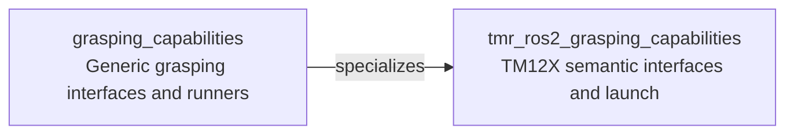

# tmr_ros2_grasping_capabilities

This package specializes the generic [grasping_capabilities](../grasping_capabilities) runners for a TMR TM12X arm. It owns the TMR motion configuration, launch files, manipulation plans, semantic interfaces, and providers.

The grasping launch includes `tm12x_moveit_config` for the TMR driver and MoveIt, followed by the generic grasping motion execution stack. The generic runner implementations and base interfaces remain in `grasping_capabilities`.

## Capability inheritance



## Build

```bash
colcon build --packages-up-to tmr_ros2_grasping_capabilities --symlink-install
```

## Run

```bash
source install/setup.bash
ros2 launch tmr_ros2_grasping_capabilities system.launch.py filename:=manipulation_1.xml use_simulation:=true
```

Set `use_simulation:=false` and supply `robot_ip:=<address>` for hardware. The system launch starts Fabric, Capabilities2, and prompt tools; set `start_prompt_tools:=false` to disable prompt tools.
